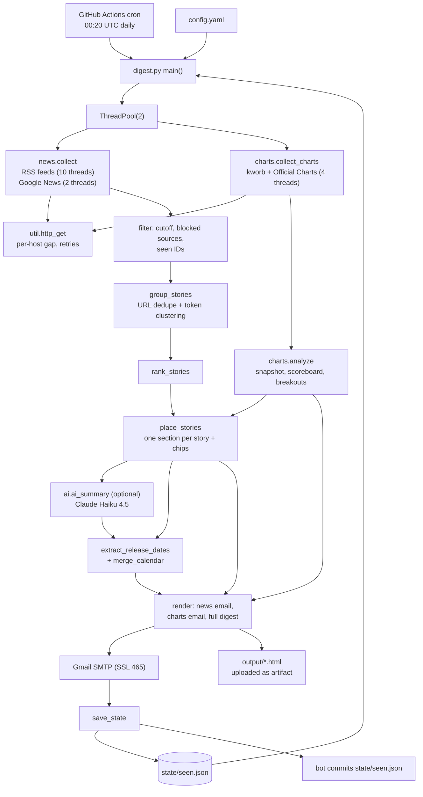
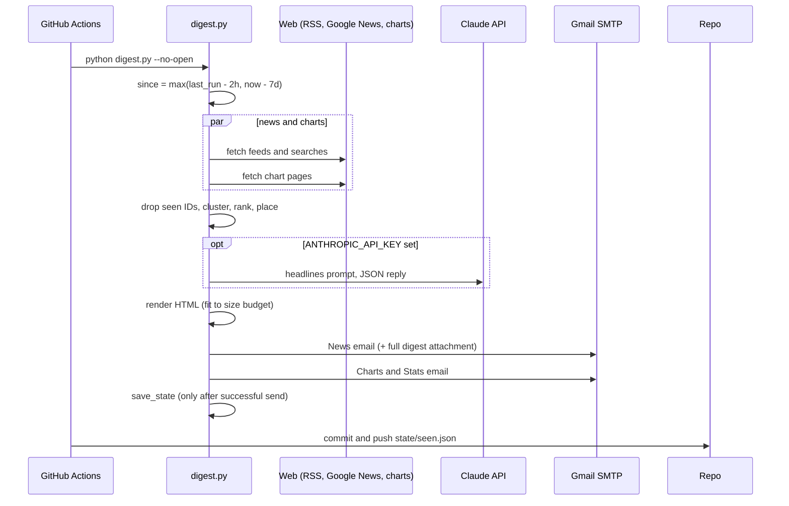

# Music Digest — Interview Deep-Dive

> **Who this is for:** me (the author), preparing to explain and defend this project in interviews.
> **How to read it:** plain English first, then technical depth. Terms are defined on first use, and there's a [Glossary](#glossary) at the end.
> **Ground rules:** checked against the code at HEAD `b1a095f`, `config.yaml`, the committed `state/seen.json`, and the git history. Anything not evidenced is marked **UNVERIFIED**.

---

## 0. TL;DR

- **What:** a daily, self-hosted **music-industry news and charts digest**, built for an independent artist preparing a first release.
  - It reads RSS feeds and Google News searches, **merges duplicate coverage into "stories"** using token-overlap similarity, ranks them, and **routes each story into one best section** (superstars, rising, independent, topics, regions, scenes) with keyword rules.
  - It scrapes **chart tables** (kworb.net, UK Official Charts) and computes "who is where", **breakouts** and number ones.
  - It builds a **release calendar** from date phrases in headlines.
  - It optionally adds a **Claude Haiku 4.5** summary, then emails two HTML digests through Gmail SMTP.
- **Runs in production:** a GitHub Actions cron (`.github/workflows/daily-digest.yml`) runs every day at 00:20 UTC. The git history shows **13 daily "Update digest memory" commits by `music-digest-bot` (3–15 Oct 2026)**, which is real evidence of it running unattended.
- **Scale (from `config.yaml`):**
  - 28 RSS feeds (26 enabled), 22 Google News searches, plus batched artist searches;
  - **222 "superstar" artists** in 9 groups, 11 rising;
  - 24 charts (20 enabled).
  - The committed state holds **13,529 seen-item IDs**, 14 calendar entries, and chart dates for 16 charts.
- **Main weaknesses:**
  - **no tests at all**;
  - order-dependent greedy clustering;
  - brittle HTML scraping for charts;
  - untrusted headlines fed straight into an LLM prompt;
  - AI-extracted release dates go into the calendar without verification.

---

## 1. One-paragraph pitch (30 seconds)

"Music Digest is a daily briefing pipeline for an independent artist. Every morning a GitHub Action pulls about 50 RSS feeds and Google News queries plus around 20 chart pages. It de-duplicates articles that cover the same event, using canonical URLs and title-token Jaccard similarity with a fuzzy-match fallback, ranks stories by how many outlets covered them, and routes each into exactly one section with weighted keyword rules. It also tracks chart breakouts, extracts upcoming release dates into a calendar, optionally asks Claude Haiku for a 60-second summary, and emails two mobile-friendly digests. State lives in a JSON file the bot commits back to the repo, so each run only shows what's new. It's been running unattended daily."

---

## 2. Plain-language explanation

**The problem.** If you're about to release your first song, you want to know what's happening in music: who's releasing what and when (so you don't release on the same Friday as a superstar), which new artists are breaking through, what's charting. That news is spread across dozens of websites and charts, and the same story gets written up ten times.

**What the script does each morning:**
1. **Reads the news**: the RSS feeds of music websites (a feed is a machine-readable list of a site's latest articles) and Google News searches.
2. **Merges duplicates**: if Billboard, NME and Rolling Stone all write "Taylor Swift announces new album", that becomes *one* story with three sources. More sources means a bigger story.
3. **Sorts stories into sections** using trigger words: superstars, rising artists, independent artists, tours, awards, legal drama, UK, hip-hop, and so on. Each story goes in exactly one section, with small tags showing other angles.
4. **Reads the charts** (Hot 100, UK Singles, Spotify, Shazam…) and spots songs that are new or jumping fast from artists not on the superstar list. Those are "breakouts".
5. **Builds a release calendar** from phrases like "out November 14".
6. **(Optional) asks an AI** to write a short "today in 60 seconds" summary.
7. **Emails two digests** and remembers what it sent, so tomorrow only has new things.

---

## 3. Architecture

### 3.1 Components

| File | Lines | Role |
|---|---|---|
| `digest.py` | 274 | Entry point: config, `.env`, state, orchestration, SMTP email, save state |
| `news.py` | 589 | Artists, source jobs, feed parsing, filters, **story clustering**, ranking, **section placement**, release dates, numbers |
| `charts.py` | 293 | kworb / Official Charts HTML parsers, chart fetch, **analysis** (snapshot, scoreboard, breakouts) |
| `render.py` | 588 | HTML/text email layout, size-fitting, full digest |
| `ai.py` | 75 | Optional Claude summary via the Messages API (raw `requests`) |
| `util.py` | 216 | Per-host polite HTTP, text cleaning, URL canonicalisation, keyword and name matchers |
| `config.yaml` | 472 | Artists, topics, regions, scenes, feeds, searches, charts, breakout rules, AI, settings |
| `.github/workflows/daily-digest.yml` | 69 | Cron, secrets, run, commit `state/seen.json`, upload artifacts |
| `state/seen.json` | — | Memory: `last_run`, `charts` dates, `calendar`, `seen` IDs |

### 3.2 Architecture diagram



### 3.3 Daily run sequence



---

## 4. Tech stack

| Library / service | Why | Alternatives / trade-offs |
|---|---|---|
| **feedparser** | Tolerant RSS/Atom parsing, normalised dates | Hand-written XML parsing (fragile) |
| **requests** | Simple HTTP; used for feeds, charts and the Claude API | `httpx` (async); official `anthropic` SDK (typed, retries) |
| **BeautifulSoup** | HTML chart tables and summary cleaning | `lxml`/`selectolax` (faster) |
| **PyYAML** | Human-editable, commented config | TOML |
| **tzdata / zoneinfo** | IST display, cron-time reasoning | — |
| **difflib.SequenceMatcher** | Fuzzy title similarity fallback | RapidFuzz (much faster); MinHash/SimHash; sentence embeddings |
| **Claude Haiku 4.5** (`claude-haiku-4-5-20251001`) | Cheapest Claude model; ~15k tokens/day ≈ 2–3 cents (README estimate) | Larger model (better summaries, higher cost); no AI |
| **Gmail SMTP + app password** | Free, no service to run | SendGrid/SES (deliverability, but setup) |
| **GitHub Actions + committed JSON state** | Free scheduler + free persistence | A small DB / KV store; GitHub Actions cache (expires) |
| `concurrent.futures` threads | I/O-bound fetching in parallel with per-host politeness | asyncio |

---

## 5. Code walkthrough

### 5.1 `digest.py`
- `load_dotenv` (`:64-74`): a tiny `.env` reader. Real environment variables win.
- **Lookback window (`:161-170`):**
  - `--hours` → `now - hours`, ignoring seen IDs;
  - otherwise `max(last_run - overlap(2h), now - 7d)`;
  - first run → 24 h.
  - The 2-hour overlap catches late-published items, and seen-ID filtering stops them being repeated.
- Fetches news and charts concurrently (`:174-178`). If *every* source failed, no digest is sent (`:180-182`).
- **Seen filter (`:184-187`):** drop items whose URL-hash *or* title-hash ID was already sent.
- Weekly charts get `fresh = False` if their chart date is unchanged since last time (`:190-192`), so the email shows a one-line reminder instead of the full table.
- Pipeline: `group_stories` → `rank_stories` → `charts.analyze` → `place_stories` → `ai_summary` → release dates (regex + AI) → `merge_calendar` → render → save HTML → email.
- **`save_state` (`:84-99`)** runs only after email succeeds (`:269`). It keeps seen IDs for 10 days, records each chart's date, and stores the calendar.
- `send_email` (`:106-136`): `multipart/alternative` (text + HTML), optionally wrapped in `multipart/mixed` with the full digest as an HTML attachment. SSL on 465, STARTTLS otherwise.

### 5.2 `util.py`
- **Per-host politeness (`_wait_turn`, `:37-47`):** a lock per host plus a minimum gap (`HOST_GAP`: Google News 1.2 s, kworb 0.5 s, Official Charts 0.8 s), safe across threads.
- **`http_get` (`:50-73`):** retries 429/5xx with linear backoff, plus timeouts and connection errors.
- **`canonical_url` (`:135-142`):** forces https, strips `www.`, drops `utm_*`/`ref*`/`fbclid` params and trailing slashes. URL de-duplication depends on it.
- **`norm_title` / `title_tokens` (`:124-132`):** lowercase, strip accents, remove possessive "'s", keep alphanumeric tokens of length ≥ 3 (or digits) that aren't stopwords.
- **`keyword_pattern` (`:156-163`):** boundary-anchored regex with light inflection (`tour` matches tours/touring), `prefix*` and `=Exact` (case-sensitive).
- **`NameMatcher` (`:166-189`):** one alternation regex per artist (longest names first), possessive tail, and an accent-free alias for names of 6+ characters ("Beyoncé" → "Beyonce", but "ROSÉ" stays). Case-sensitive "=" names avoid collisions with everyday words (e.g. "=TWICE").

### 5.3 `news.py`
- **Jobs (`build_jobs`, `:141-173`):** feeds; configured Google News searches (`when:{days}d`, edition params); and **artist batch searches**, 10 names per `("A" OR "B" …)` query, grouped by artist group. Exact-case names are skipped because Google ignores case.
- **`parse_feed` (`:176-211`):** for Google News items the real outlet comes from `<source>` or a trailing " - Outlet" in the title, and the suffix is removed. Summaries are cleaned for direct feeds only.
- **`Filters` (`:214-224`):** blocked sources (Google News only) and blocked title regexes (e.g. ticket listings, social posts).
- **Clustering (`group_stories`, `:286-315`):**
  1. Exact de-duplication by canonical URL, preferring direct-feed items over search items.
  2. Sort: direct feeds first, newest first.
  3. **Greedy single-pass clustering with an inverted index** (token → stories), so each new item is only compared against candidate stories sharing a non-generic token. That makes it roughly linear instead of O(n²) on ~1,000 items.
  4. **`same_story` (`:277-283`):**
     - require at least 2 shared *non-generic* tokens;
     - then either Jaccard ≥ 0.45 with ≥ 3 shared tokens, or `SequenceMatcher` ratio ≥ 0.75 with ≥ 3 shared.
     - `GENERIC` (`:269-274`) removes music boilerplate ("album", "tour", "video"…) so two unrelated "X announces tour" stories don't merge.
  5. *Subtlety:* a story's `tokens` are those of its **first** item and never updated. That prevents cluster drift but misses transitive merges.
  6. Items in a story are sorted so the lead is a direct-feed item with a summary.
- **Ranking (`rank_stories`, `:325-337`):** `3 × #outlets + 2 (top outlet) + 1 (< 12 h old) + 0.5 (lead from a direct feed) + 0.3 (has summary)`.
- **Placement (`place_stories`, `:372-464`):**
  - Keyword scores: title hits ×2, body hits ×1, plus feed-tag boosts.
  - Precedence: pinned → **biggest (≥ 3 outlets)** → superstar → rising (score ≥ 2, or rising tier or breakout hit) → independent → strong topic → scene → region (only if mentioned in the title) → weak topic → "More headlines".
  - **Chips** record secondary angles (country flags, scene, topic, "Rising", "Indie").
  - **Breakout names from the charts feed into news routing** (`breakout_hit`, `:397`). Chart signal informs news placement.
- **Release dates (`:470-556`):**
  - regexes for "verb + month + day" (`DATE_RE`), parenthetical dates (`PAREN_RE`), and relative phrases ("this Friday", "tomorrow", `REL_RE`);
  - `_resolve` handles the year: more than 60 days in the past means next year, between 3 and 60 days past is dropped;
  - `merge_calendar` keys by date + artists, so entries persist across days.
- **Numbers (`extract_numbers`, `:576-589`):** regexes for units, streams and sales ("1.2 million streams") with multipliers. Only the first number ≥ 1,000 per story is kept.

### 5.4 `charts.py`
- **`parse_kworb` (`:87-133`):** finds the first table whose header has "artist"/"track", maps columns by header name (pos, P+, streams/pts, peak, days/wks), and splits "Artist - Title". Chart date is the first `YYYY/MM/DD` on the page.
- **`parse_officialcharts` (`:136-171`):** CSS selectors (`.chart-item`, `a.chart-name`, `li.movement`…). `smart_title` de-capitalises ALL-CAPS titles but keeps short acronyms (BTS, DJ).
- **`analyze` (`:236-293`):**
  - snapshot = row 1 of each chart;
  - **scoreboard** = each followed artist's best position per chart;
  - **breakouts** = rows by non-superstar artists that are NEW/RE within the top 100, jumped ≥ 15 places, or sit in Shazam's top 25. Keyed by normalised title + first credited artist, ranked by the number of charts as evidence.
  - Breakout artist names (≥ 4 chars, not "various"…) become `NameMatcher`s for news routing.

### 5.5 `ai.py`
- Builds a prompt with ≤ 160 headlines spread evenly across non-empty sections (`per_section = max(4, budget // n)`).
- Asks for **JSON only** (brief, section_notes, releases, artist_takeaway), with the rule "Use only facts present above. Never guess numbers or dates."
- Raw `requests.post` to `/v1/messages` (`anthropic-version: 2023-06-01`, `max_tokens 2000`, `timeout 120`).
- **Parses JSON by slicing from the first `{` to the last `}`** (`:64`). Any exception means the summary is skipped and the digest still sends.

### 5.6 `render.py`
- Every interpolated value goes through `esc()` (`html.escape`); there are 44 call sites. AI text is escaped too, which is good, because the LLM output is untrusted.
- `fit(render_fn, levels, max_bytes)` (`:389`) renders progressively shorter "levels" until the email fits a size budget (`max_email_kb`, default **95 KB**, `render.py:399`). That's how it avoids Gmail's ~100 KB clipping.

### 5.7 `.github/workflows/daily-digest.yml`
- `cron: "20 0 * * *"` plus `workflow_dispatch` with an optional `hours` input, validated with a regex `^[0-9]+$` before use. This protects against shell injection from the input.
- `permissions: contents: write`; a concurrency group without cancellation; `timeout-minutes: 25`.
- Commits `state/seen.json` as `music-digest-bot`, with `pull --rebase --autostash` before pushing. Uploads `output/*.html` as a 14-day artifact even if earlier steps fail.

---

## 6. Core concepts & theory

### 6.1 Near-duplicate detection
- **Jaccard similarity** $J(A,B) = \frac{|A\cap B|}{|A\cup B|}$ on title token sets. A threshold of 0.45 plus a minimum shared count guards against short-title false matches.
- **SequenceMatcher ratio** $= 2M/T$, where M is the matching characters and T the total characters (Ratcliff/Obershelp). It's order-aware and catches reworded titles with high character overlap.
- **Blocking with an inverted index:** only compare items sharing a rare token. It's the same idea as candidate generation in entity resolution and LSH.
- **Greedy single-link vs centroid clustering:** this implementation compares against the *seed* item only, which is closer to "leader clustering". It's order-dependent and doesn't chain.

### 6.2 Story importance
- Coverage breadth (number of distinct outlets) is a strong, robust signal of newsworthiness. It's the same signal used in Google News clustering and in "trending" detection.
- Linear additive scores are interpretable. They could be replaced by learning-to-rank on clicks (no click data is collected here).

### 6.3 Rule-based text classification
- Weighted keyword voting with title > body, then a precedence ladder. It's equivalent to a hand-built decision list.
- Pros: transparent and editable in YAML. Cons: no probabilities, brittle to phrasing. Ambiguous stories get one home plus chips, which reduces duplication across sections.

### 6.4 Information extraction with regex
- Release dates and sales numbers come from pattern templates (verb + month + day). There's an inherent precision/recall trade-off, and year resolution needs heuristics (the 60-day rule).

### 6.5 LLM summarisation with structured output
- JSON-only prompting, grounding instructions, and graceful degradation on failure.
- Risks:
  - **hallucination** (dates and numbers not in the input);
  - **prompt injection** (headline text is untrusted input inside the prompt);
  - output-format drift (handled with try/except).
- Better: tool use / JSON schema, then validate extracted dates by checking the string appears in the source text.

### 6.6 Idempotent scheduled jobs
- **At-least-once delivery:** state is saved only after email succeeds, so a failure retries the same content next run rather than skipping it.
- The `seen` set with a 10-day TTL is a sliding-window de-duplication store.

---

## 7. Data

- **Inputs:**
  - RSS/Atom items: title, link, published, summary.
  - Google News items: title + source; no summary.
  - Chart rows: pos, title, artist, move, peak, weeks, metric.
- **Config:** artists (pinned / superstars by 9 groups / rising, plus aliases), topics with keywords and `strong` flags, regions, scenes, feeds with tags, searches, charts, breakout thresholds.
- **State schema (`state/seen.json`):** `{last_run, charts: {id: date}, calendar: {"date|artists": entry}, seen: {id: timestamp}}`. At HEAD: 13,529 seen IDs, 14 calendar entries, 16 chart dates.
- **No ML training data and no labels.** Evaluation-style risks:
  - keyword lists tuned by eye on the same days they run on;
  - no ground truth for clustering or section placement.

---

## 8. Evaluation & results

- **Operational evidence:** 13 consecutive daily bot commits (`git log`, 3–15 Oct 2026). The pipeline runs, emails send (state is only saved after a successful send), and memory updates.
- **No quality metrics:** no measurement of clustering precision/recall, section accuracy, date-extraction precision, or AI-summary faithfulness. **No tests.**
- **README claims:** "about 75 sources" and "16+ charts" are **UNVERIFIED** as exact counts. Config shows 26 enabled feeds + 22 searches + artist batches, and 20 enabled charts. The cost estimate (~15k tokens, 2–3 cents/day) is an estimate in the README, not logged.
- **What sound evaluation would look like:**
  - label one day's ~1,000 items into true stories and measure pairwise precision/recall (or B-cubed F1) of clustering;
  - label section placement for 200 stories;
  - check each AI-claimed release date against source text.

---

## 9. Design decisions & trade-offs

| Decision | Gained | Lost |
|---|---|---|
| RSS + Google News instead of scraping publisher sites | Legal-ish, structured, robust; covers paywalled outlets via headlines | Google News items have no summary; depends on Google's feed |
| Lexical clustering (Jaccard + SequenceMatcher) | Fast, dependency-free, explainable | Misses paraphrases ("Swift unveils LP" vs "Taylor drops new record"); order-dependent |
| One section per story + chips | No duplicates across sections | A misrouted story is hidden from the right section |
| HTML chart scraping | Access to tables with no API | Breaks on site redesign; possible ToS questions |
| Committed JSON state | Free persistence across runs | ~1–2k-line diffs per day in git history; merge risk with concurrent runs (mitigated by the concurrency group) |
| Optional LLM summary | Human-friendly brief; cheap | Hallucination/injection risk; non-deterministic |
| Save state only after email success | No lost digests | Possible duplicates if the second email fails after the first sends |

---

## 10. Honest weaknesses

1. **No automated tests** for parsers, clustering, placement, date extraction or rendering. Chart HTML changes or regex regressions are only noticed by reading the email.
2. **Clustering is order-dependent and seed-based** (`group_stories`, `:295-312`). A story's tokens come from its first item only. Paraphrased coverage isn't merged, which under-counts "biggest stories".
3. **Seen-ID by normalised title** (`Item.ids`, `:41-43`): two *different* articles with the same headline (recurring columns like "New Music Friday") are suppressed for 10 days.
4. **AI release dates enter the calendar unverified** (`digest.py:209-213`), tagged "AI summary" but not checked against the source text.
5. **Prompt injection surface:** headlines and summaries from arbitrary feeds go into the LLM prompt (`ai.py:28-40`). Output is HTML-escaped, so the impact is limited to misleading text.
6. **JSON extraction by brace slicing** (`ai.py:64`) breaks if the model includes braces in prose. There's no schema validation beyond type checks.
7. **Scraped charts are brittle** (CSS selectors and header names). Failures are surfaced in the email footer, which is good, but not alerted.
8. **Partial-send duplicates:** if the News email sends but the Charts email fails, state isn't saved, and tomorrow's News email repeats today's.
9. **`extract_numbers` keeps only the first number ≥ 1,000 per story**, not the largest or most relevant.
10. **Git history bloat:** a daily commit rewriting a 13k-line JSON file.
11. **Hard-coded thresholds** (0.45 Jaccard, 0.75 ratio, 3 outlets, jump ≥ 15) were never tuned against labelled data.

---

## 11. How I'd improve it (prioritised)

| # | Change | Effort | Impact |
|---|---|---|---|
| 1 | **Golden-file tests:** save a day of raw feeds and chart HTML as fixtures; test clustering, placement, date extraction and parsers; run them in CI on every push | 1 day | Catch regressions and site changes |
| 2 | **Labelled clustering eval** (one day, ~1,000 items) → tune thresholds by pairwise F1; try **sentence embeddings** (e.g. a MiniLM model) + cosine for paraphrase merging | 1–2 days | Better "biggest stories", measurable |
| 3 | Cluster against a **centroid / all members** (union-find over the candidate graph) instead of seed-only | 0.5 day | Order-independence |
| 4 | **Validate AI outputs:** require each release `date` string to appear in a cited headline; use tool-use/JSON schema; delimit untrusted text and tell the model to treat it as data | 0.5 day | Fewer hallucinated dates; injection hardening |
| 5 | Per-email state (record "news sent" separately) | 2 hours | No duplicate digests |
| 6 | Seen-ID by URL plus (title, source), not title alone | 1 hour | Fewer false suppressions |
| 7 | Move state to the Actions cache or a tiny KV store; prune history | 0.5 day | Stop repo bloat |
| 8 | Alert on chart parse failures (e.g. GitHub issue or email flag) | 2 hours | Faster fixes |
| 9 | Use the official `anthropic` SDK with retries and usage logging (record real token counts and cost) | 2 hours | Verifiable cost claims |

---

## 12. How to run it

```bash
pip install -r requirements.txt          # feedparser, requests, beautifulsoup4, PyYAML, tzdata
python digest.py --preview               # build and open in browser; no email, no state
cp .env.example .env                     # then fill in the values below
python digest.py                         # build, email, remember
python digest.py --hours 72              # ignore memory, look back 72 h
```
**Env vars (names only):**
- `EMAIL_ADDRESS`
- `EMAIL_APP_PASSWORD`
- `EMAIL_TO` (optional)
- `ANTHROPIC_API_KEY` (optional)
- `SMTP_HOST`, `SMTP_PORT` (optional overrides)
- `LOOKBACK_HOURS` (workflow input)
- `CI` / `GITHUB_ACTIONS` (read to suppress the browser)

**GitHub Actions:** add the same names as repository secrets. It runs daily at 00:20 UTC (05:50 IST), or manually via *Run workflow*.

---

## 13. Resume bullets (truthful)

- Built and **deployed a daily news-aggregation pipeline** (Python, GitHub Actions cron) that ingests ~50 RSS / Google News sources and ~20 chart pages, de-duplicates coverage via **URL canonicalisation + token-Jaccard / fuzzy title clustering with an inverted-index blocker**, and emails two mobile digests. It has run unattended daily (13 consecutive automated runs in the repo history).
- Implemented **rule-based story routing** across ~25 sections (222-artist name matcher with alias and accent handling, weighted keyword topics/scenes/regions) and **chart analytics** (cross-chart artist scoreboard, breakout detection from new entries, jumps and Shazam signals).
- Integrated an **LLM (Claude Haiku 4.5) summary with JSON-structured output** and graceful fallback, plus regex **information extraction** for release dates and sales figures into a persistent release calendar.

---

## Glossary

- **RSS/Atom feed**: a machine-readable list of a site's latest posts.
- **Canonical URL**: one standard form of a URL (no tracking params), used to spot duplicates.
- **Jaccard similarity**: overlap of two sets ÷ their union.
- **SequenceMatcher ratio**: Python's character-level similarity score (0–1).
- **Inverted index**: a map from each word to the items containing it.
- **Cluster / story**: a group of articles about the same event.
- **Cron**: a schedule format ("20 0 * * *" = 00:20 every day, UTC).
- **SMTP / app password**: the email-sending protocol / a separate password for scripts.
- **Prompt injection**: untrusted text in a prompt that tries to steer the model.
- **Hallucination**: an LLM stating something not supported by its input.
- **Breakout**: a song from a non-superstar artist that's new, jumping, or trending on Shazam.
- **Idempotent / at-least-once**: re-running doesn't double effects / work may be repeated but never lost.
